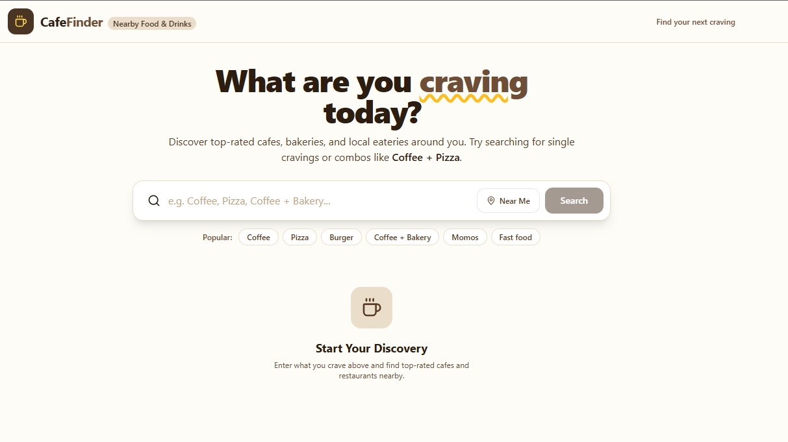

# ☕ CafeFinder

Find nearby cafes and restaurants by what you feel like eating or drinking.

Type something like `coffee`, `momos`, or `coffee + pizza`, share your location, and CafeFinder shows matching places near you with ratings, distance, open/closed status, and Google Maps directions.


## Features

- Search by food or drink, including multiple keywords
- Uses your browser location to find places nearby
- Shows rating, review count, address, photo, distance, and open status
- One-click directions in Google Maps
- Filters for distance and rating
- Responsive on desktop and mobile

## Tech Stack

| Part | Tools |
|------|-------|
| Frontend | React, TypeScript, Vite, CSS, Axios |
| Backend | Python, Django, Django REST Framework |
| API | Google Places API (New) |
| Other | Browser Geolocation API, `.env` config, Git/GitHub |

## What I Built

- A REST API in Django that takes a search and a location, then returns clean JSON
- Integration with the Google Places API, with results merged across multiple keywords and duplicates removed
- A React + TypeScript frontend with loading, error, and empty states
- Browser geolocation handling, including denied permissions
- Secure API key handling: the key stays on the backend in `.env` and is never exposed to the frontend

## How It Works

```
React (keywords + location) → Django API → Google Places API → cleaned JSON → React cards
```

## Run Locally

**Backend**
```bash
cd backend
python -m venv venv
venv\Scripts\activate        # macOS/Linux: source venv/bin/activate
pip install -r requirements.txt
```
Create `backend/.env`:
```
GOOGLE_PLACES_API_KEY=your_key_here
```
```bash
python manage.py runserver
```

**Frontend** (new terminal)
```bash
cd frontend
npm install
npm run dev
```
Open http://localhost:5173

You need a Google Cloud project with **Places API (New)** enabled and billing set up to get an API key.

## API

`GET /api/places/search/?query=coffee&latitude=27.7172&longitude=85.3240`

Returns a list of places with name, address, rating, review count, distance, open status, photo, and a Maps link.

## Limitations

- Data depends on Google Places, so photos and opening hours aren't always available
- Google API usage may cost money
- No database; everything is fetched live

## Project Structure

```
CafeFinder/
├── backend/    # Django + DRF (config/, places/)
└── frontend/   # React + TypeScript (src/components, src/services)
```